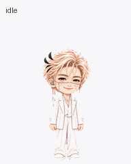

# 童童的侯明昊

浅金发、白色舞台装、银色水滴面链的 Q 版桌宠。这个仓库保存最终透明动画图集、预览与素材参数，便于备份和后续修改。

## 动作

- 日常待机：眨眼、轻微呼吸。
- 左右移动：交替迈步。
- 招手与小跳。
- 思考：托腮、低头和轻点头。
- 等待：歪头、掌心向上邀请回应。
- 困惑：轻皱眉、挠头。
- 完成：微笑，右脸旁的粉色心心向右横着飘开，逐渐缩小消失。
- 跟随鼠标：十六个方向的抬头、低头与左右转头。

## 预览

| 待机 | 完成时的右侧心心 | 转头 |
| --- | --- | --- |
|  |  |  |

[完整视频预览](all-states.mp4) · [待机与小跳衔接](idle-jump-idle.gif)

## 素材

`spritesheet.png` 是 v2 透明图集，尺寸为 **1536 × 2288**，采用 **8 列 × 11 行**，每格 **192 × 208**。共包含 73 个有效帧，未使用的格子保持透明。

| 行（从 0 开始） | 状态 | 帧数 |
| --- | --- | --- |
| 0 | idle | 6 |
| 1 | running-right | 8 |
| 2 | running-left | 8 |
| 3 | waving | 4 |
| 4 | jumping | 5 |
| 5 | failed | 8 |
| 6 | waiting | 6 |
| 7 | running（思考工作） | 6 |
| 8 | review（完成） | 6 |
| 9 | 注视方向 000°—157.5° | 8 |
| 10 | 注视方向 180°—337.5° | 8 |

注视方向从上方 000° 开始，按顺时针排列，每步 22.5°。素材适用于支持此 v2 格式的自定义桌宠流程；`metadata.json` 是本仓库的素材说明文件。

## 检查记录

已完成透明背景、有效帧、空白格、动作位置、跳跃落地和注视方向检查。独立方向盲审通过。摘要见 `validation-summary.json`，文件校验值见 `SHA256SUMS`。

角色图像使用内置图像生成工具制作，动画帧通过桌宠制作流程提取、对齐和合成。
